**#feedback yang diberikan beserta bukti perbaikan:** 
1. Buat file _layout.tsx dan gunakan tab navigation bawaan Expo Router — Belum. Ini poin paling kritis: tanpa file ini aplikasi tidak bisa berjalan. Bottom bar manual yang dibuat sendiri di tiap layar perlu diganti dengan tab navigation bawaan agar perpindahan halaman stabil dan rapi 
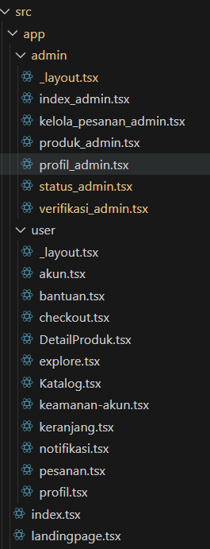
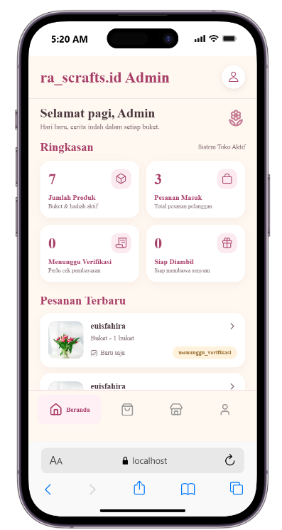
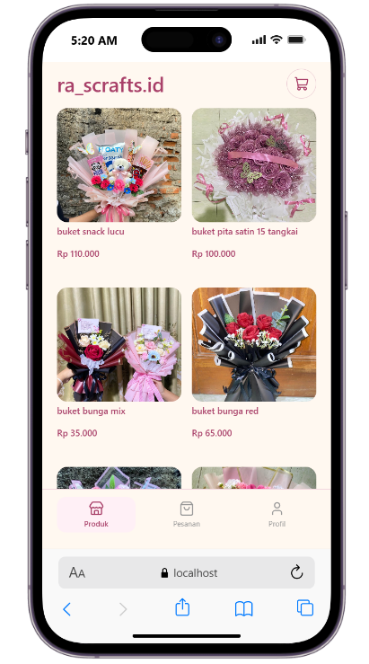

2. Dropdown pilihan status permintaan — Valid, Ditolak, Diperbaiki — beserta field keterangan tambahan — Belum. Field keterangan menjelaskan alasan perbaikan atau penolakan, sehingga pengguna tidak perlu mengulang transaksi dari awal. Fitur kecil ini sangat terasa manfaatnya bagi pengalaman pengguna 
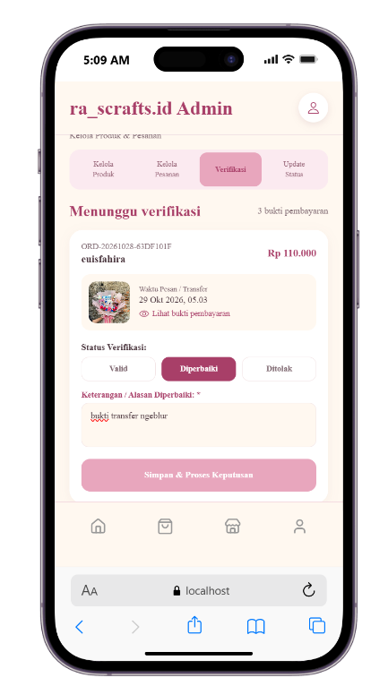

3. Buat minimal 3 komponen reusable — Belum. File komponen sebenarnya sudah ada, tetapi belum dipakai di layar-layar kalian. Mulailah memakai komponen yang sudah dibuat itu — pekerjaan kalian akan jauh lebih ringan setelahnya 
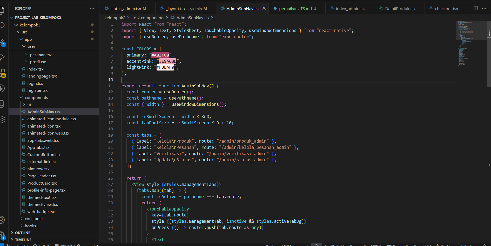
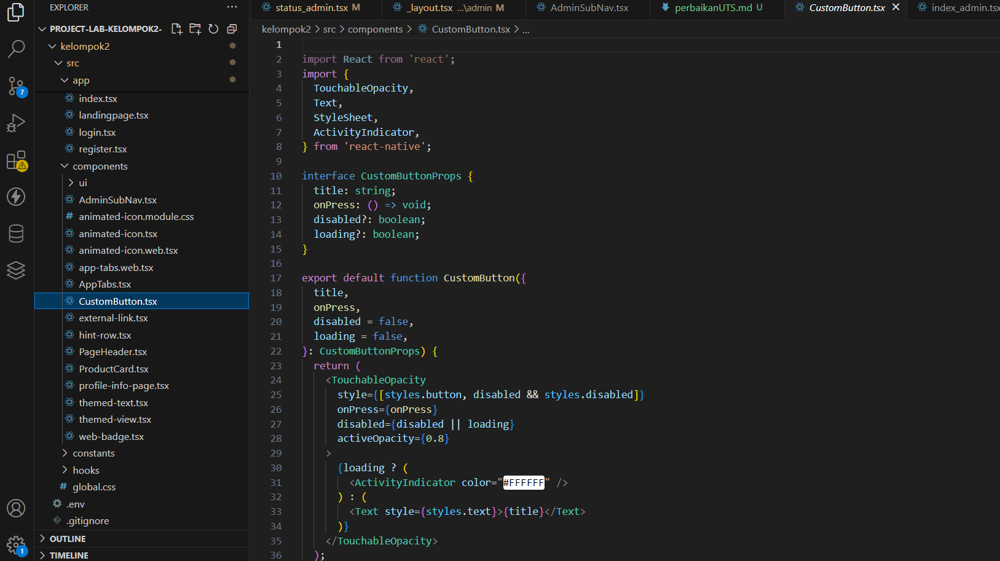
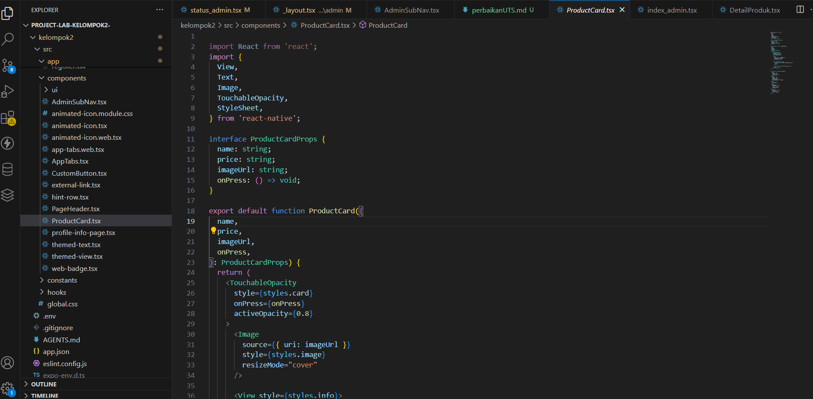
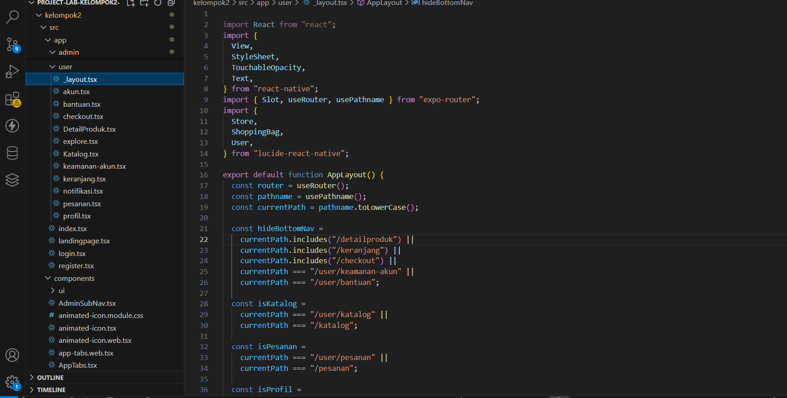
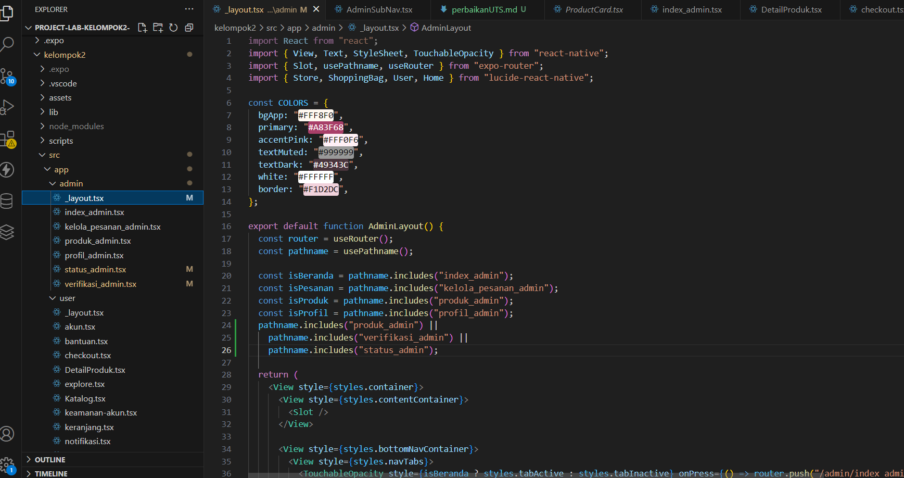

4. Pastikan aplikasi menggunakan emulator HP, bukan berbasis web — Belum. Masih ada kode khusus web di halaman keranjang dan checkout yang perlu diganti dengan cara bawaan mobile, misalnya memakai expoimage-picker untuk mengunggah bukti 
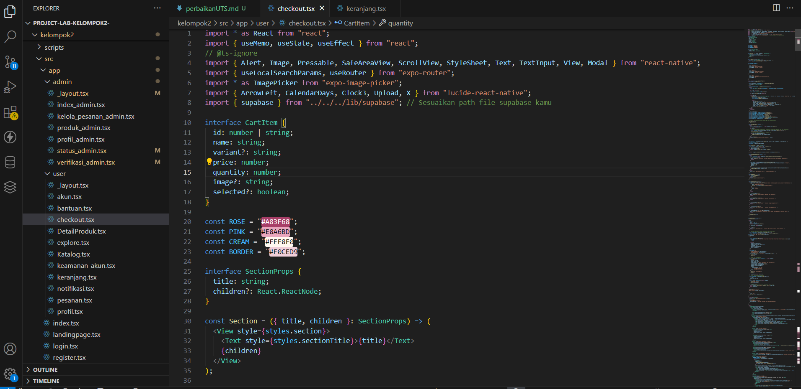
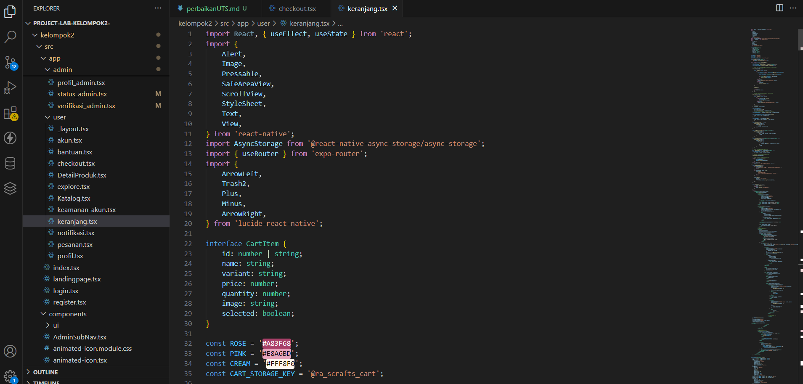

<video controls src="perbaikan.mp4" title="Title"></video>
<video controls src="perbaikanadmin.mp4" title="Title"></video>

