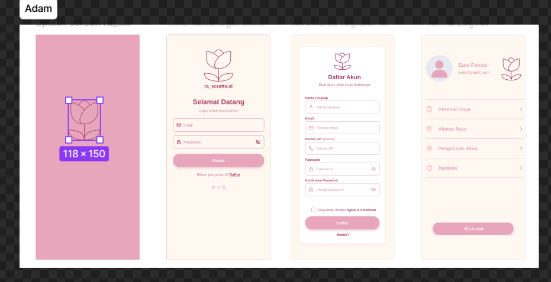
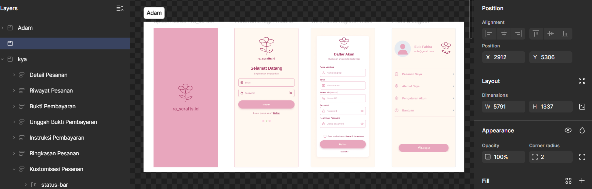
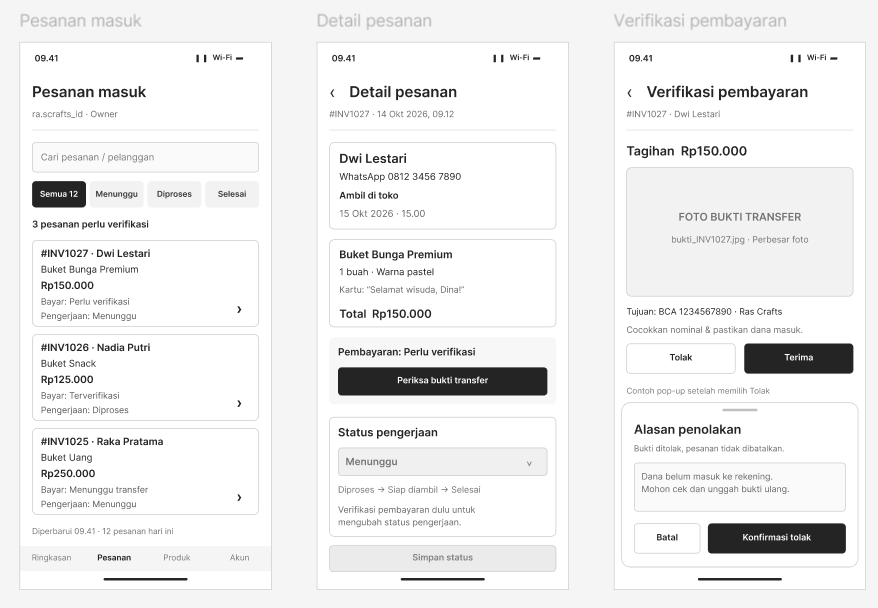
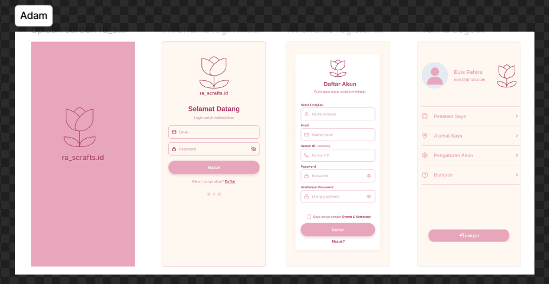

### proses pengembangan 2

Anggota Kelompok:

1. Euis Fahira Yuningsih_2488010055
2. Maddinatul Dzahra Aulia Gusman-2488010058
3. Adam Fadli_2488010028
4. Lailatul Qodariah_2488010006
5. Chantika Maharani_2488010080

tema proyek: UMKM

judul: "ra.scrafts_id: Aplikasi Pemesanan dan Katalog Digital Buket Berbasis Mobile."

**_pembagian jobdesk_**

- Adam Fadli: Infrastruktur Database & Otentikasi Pengguna
  Bertanggung jawab dalam perancangan struktur basis data utama sistem serta pengembangan seluruh modul Otentikasi Pengguna. Tugas mencakup pembuatan fitur Registrasi & Login Pelanggan menggunakan email atau nomor telepon, fitur Login Admin untuk hak akses owner, serta pengelolaan sesi profil dan logout.
  
  
- Maddinatul Dzahra Aulia G.: Katalog Digital Sisi Pelanggan
  Bertanggung jawab dalam pengembangan antarmuka utama pengguna dan Katalog Digital. Tugas mencakup penyajian daftar koleksi buket ra.scrafts_id lengkap dengan foto, deskripsi, dan harga, penyediaan fitur pencarian dan filter kategori produk (buket bunga, uang, snack), serta informasi detail produk dan ketersediaan stok.
  

- Lailatul Qodariah: Pemesanan & Riwayat Transaksi Pelanggan
  Bertanggung jawab atas seluruh alur transaksi In-App Checkout Form dan riwayat pesanan pelanggan. Tugas mencakup pengisian detail kustomisasi produk (pita, wrapping, catatan), teks kartu ucapan, informasi transfer manual, upload bukti pembayaran, hingga pemantauan riwayat dan status pesanan real-time (Pending, Diproses, Dalam Pengerjaan, Dikirim/Selesai).
  
  
  
  
  

- Chantika Maharani: Manajemen Pesanan Sisi Admin
  Bertanggung jawab atas pengelolaan modul Order Management untuk sisi owner. Tugas mencakup pemantauan seluruh pesanan masuk dari pelanggan, proses pengecekan dan verifikasi foto bukti pembayaran transfer manual, serta pembaruan status pengerjaan pesanan secara real-time.
  

- Euis Fahira Y: Manajemen Katalog & Laporan Penjualan Sisi Admin
  Bertanggung jawab atas pengelolaan operasional toko dan rekapitulasi data pada dashboard admin. Tugas mencakup fitur Manajemen Katalog atau CRUD produk (tambah, ubah, hapus, dan pembaruan stok/varian buket) serta penyajian Laporan Penjualan Ringkas berupa rekapitulasi total pesanan dan pendapatan bulanan toko.
  

5. SS minimal sketch up > sudah ada halamannya (member)
