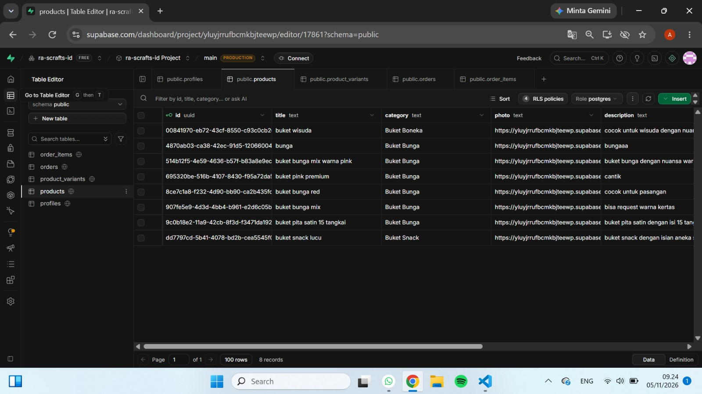
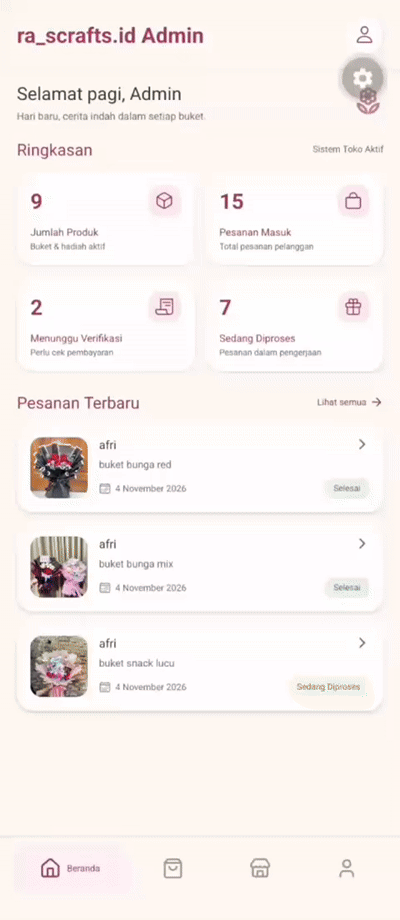

**kelompok 2**
1. Adam Fadli
2. Euis Fahira Yuningsih
3. Chantika Maharani
4. Lailatul Qodariah
5. Maddinatul Dzahra Aulia Gusman

Menambahkan fungsionalitas manajemen produk secara lengkap (Create, Read, Update, Delete) pada panel Admin untuk memudahkan pengelolaan katalog buket dan variasi produk secara real-time melalui basis data Supabase.

**Ringkasan Perubahan & Fitur yang Ditambahkan**
- Read (Menampilkan Data Produk):
Halaman admin dihubungkan ke tabel products dan product_variants pada Supabase untuk menampilkan daftar produk, deskripsi, harga, serta stok yang tersedia secara dinamis.

- Create (Menambah Produk Baru):
Menyediakan form input bagi admin untuk memasukkan nama produk baru, deskripsi, unggah gambar (image URL), serta konfigurasi varian ukuran dan harga.

- Update (Memperbarui Data Produk):
Memungkinkan admin untuk mengubah informasi produk (seperti memperbarui harga, stok, atau deskripsi ukuran) yang langsung tersimpan dan disinkronkan ke database.

- Delete (Menghapus Produk):
Menambahkan fungsi penghapusan data produk beserta variannya dari database agar katalog tetap bersih dan akurat.

**tabel supabase:**

