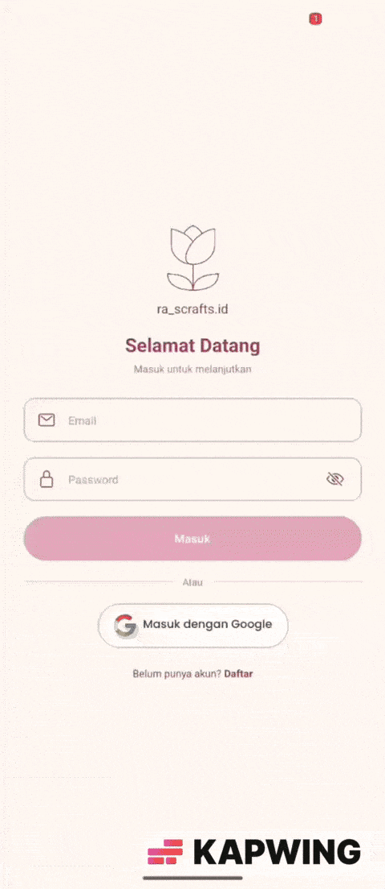

**#Implementasi Login Google (OAuth)**

**kelompok 2**
1. Adam Fadli
2. Euis Fahira Yuningsih
3. Chantika Maharani
4. Lailatul Qodariah
5. Maddinatul Dzahra Aulia Gusman

Fitur: Autentikasi Pengguna menggunakan Akun Google (login.tsx)

Teknologi: Expo Router, Supabase Auth, expo-auth-session, expo-web-browser, expo-linking

Ringkasan Pengembangan
Telah diimplementasikan fitur autentikasi Masuk dengan Google melalui fungsi handleGoogleLogin pada halaman login.tsx. Fitur ini mendukung proses login lintas platform (Web dan Android/Expo Go), pertukaran authorization code menjadi sesi aktif, pembuatan profil otomatis bagi pengguna baru di tabel profiles dengan role default 'user', serta pengalihan halaman (routing) otomatis berdasarkan hak akses (admin ke /admin/index_admin dan user ke /user/Katalog).

bukti 